<div align="center">
  <h1>JSON Assistant</h1>
  <p>A focused workspace for editing and inspecting JSON.</p>

  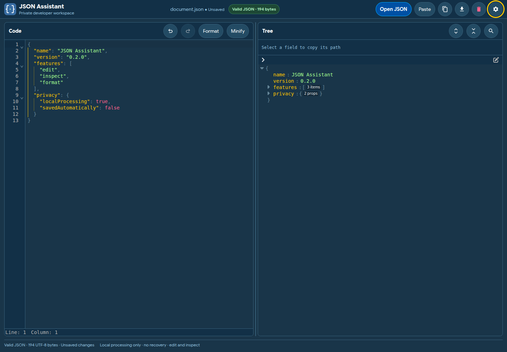
</div>

A browser-based workspace for inspecting and editing one JSON document at a time. Try the [hosted app](https://json-assistant-one.vercel.app/).

## Features

- Inspect and edit JSON in Code, Tree, or Split views; search source and tree fields.
- Open or paste a document, format or minify it, undo or redo edits, copy paths or subtrees, and download the source.
- Choose editor fonts, color themes, and light/dark appearance.
- Process documents in the browser. The host serves the app and its static assets; the app does not upload JSON documents to a backend.

## Themes and fonts

<details>
<summary>Compare all themes in light and dark mode</summary>

| Theme | Editor font | Light | Dark |
| --- | --- | --- | --- |
| Tokyo Night | JetBrains Mono | 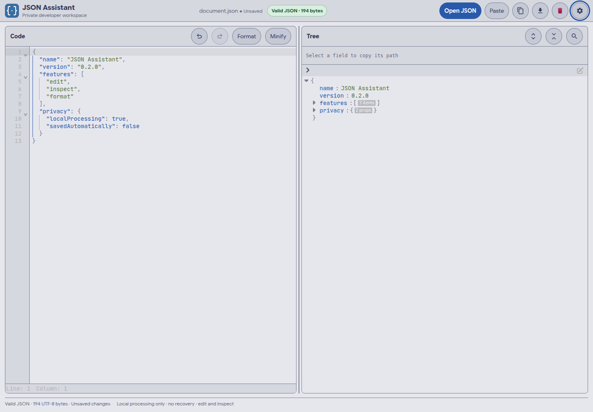 | 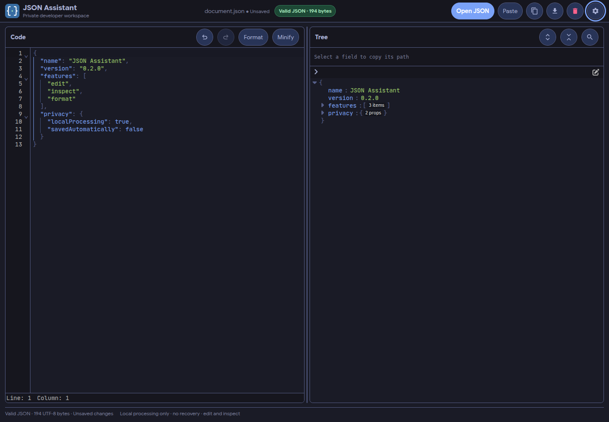 |
| Catppuccin | Iosevka Mono | 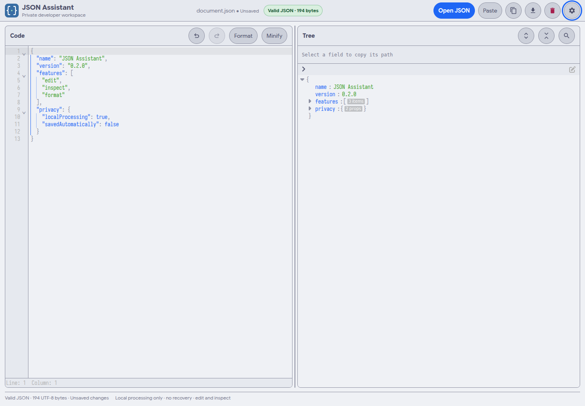 | 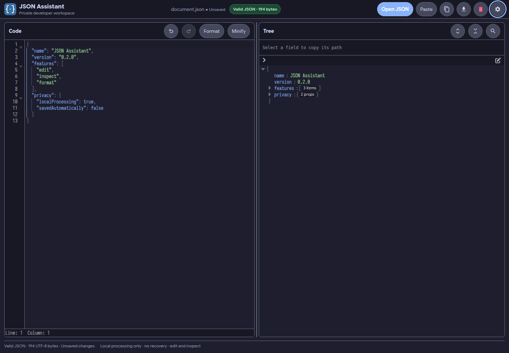 |
| Rosé Pine | Cascadia Code | 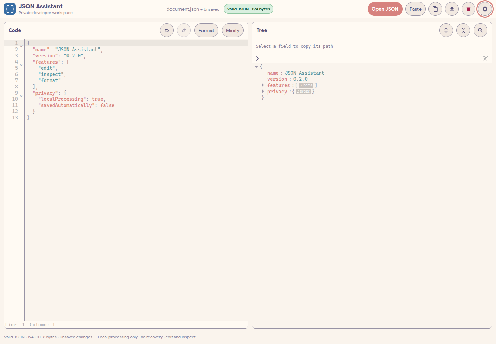 | 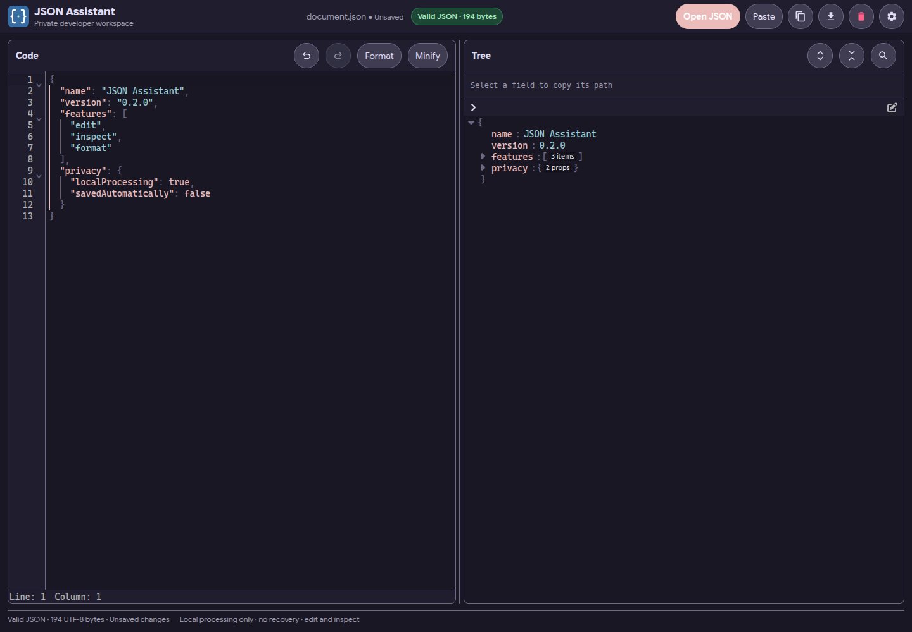 |
| Solarized | Fira Code | 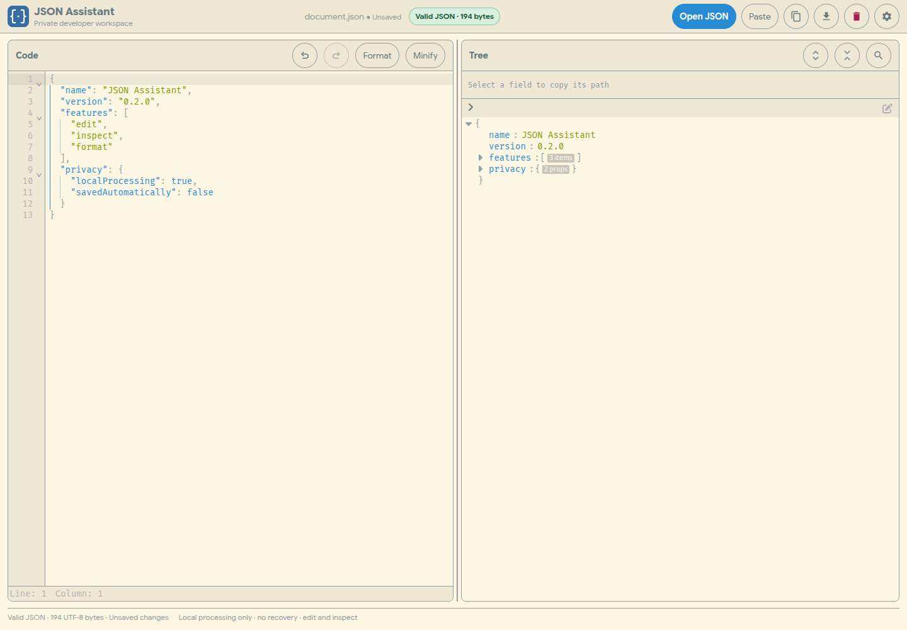 | 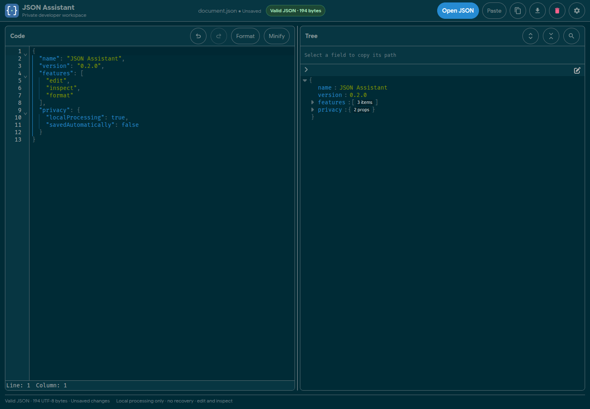 |
| VS Code Dark+ | System default | 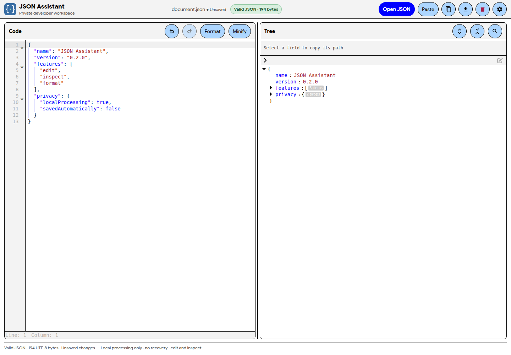 | 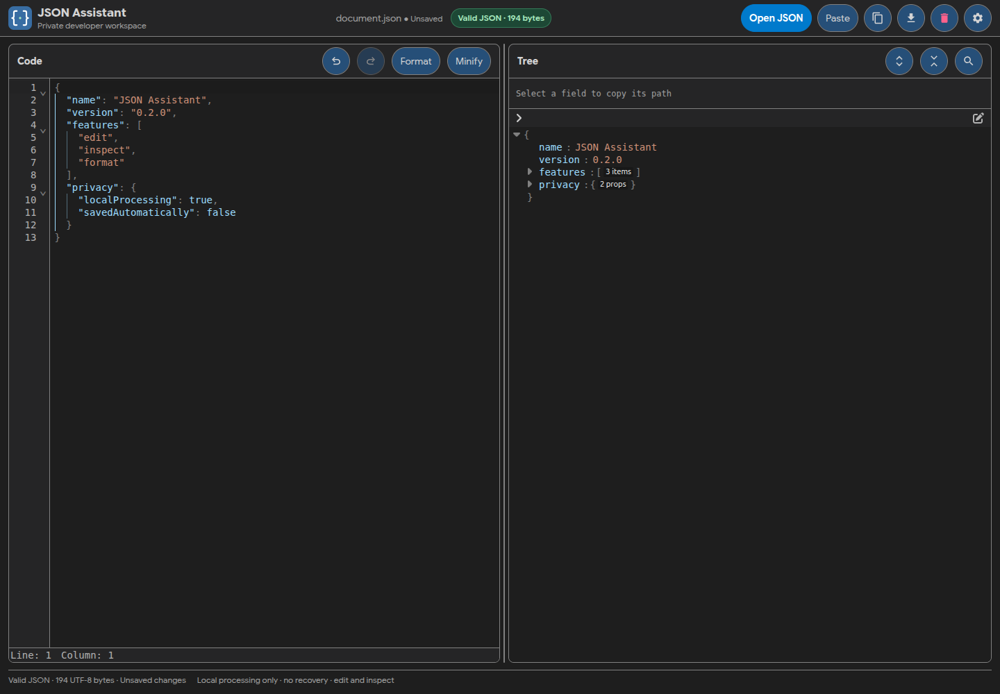 |
| GitHub | JetBrains Mono | 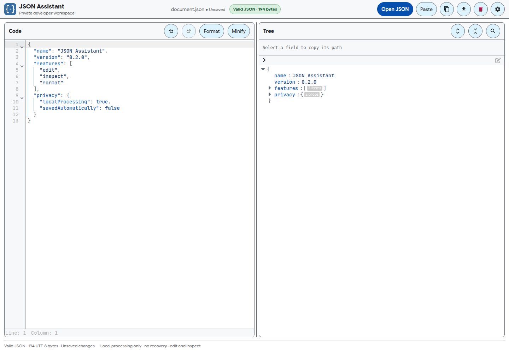 | 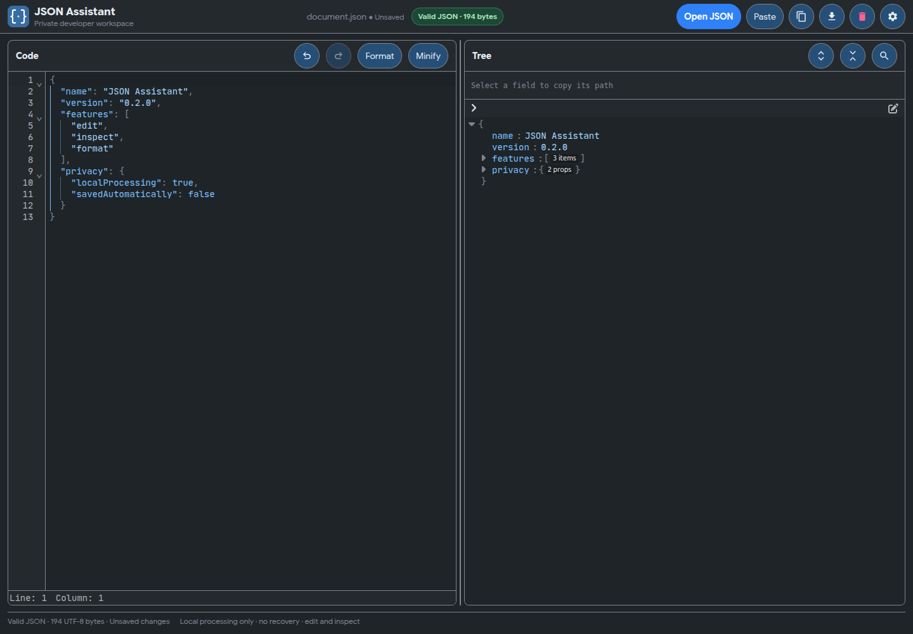 |

</details>

## Run locally

Requires Node.js 22.12 or newer and Yarn.

```sh
yarn install --frozen-lockfile
yarn dev
```

Open the local URL printed by Vite. JSON documents remain in the current browser session; they are not automatically saved or recovered. Export important work before closing or refreshing the page.

## Development checks

```sh
yarn check       # Svelte and TypeScript checks
yarn test        # Unit tests
yarn test:e2e    # Browser tests in Chromium and Firefox
yarn build       # Production build
yarn benchmark   # Generated browser fixtures; output is gitignored
```

## Limits and privacy

Processing is client-side; serving the site still requires normal requests for the app and its assets. The app has no account or cloud-document workflow, and does not automatically persist document content. Browser memory and responsiveness vary by device and document shape; benchmark sizes are test inputs, not quotas or support promises. The 1 MiB broad-array workflow is unsupported, and 100 MB benchmark cases crashed or timed out. See the [release verification](docs/verification/2026-10-17-release.md) for measurements and details. Do not treat the app as unlimited-size storage or the sole copy of important data.

## Project documentation

- [Design specification](docs/superpowers/specs/2026-10-17-json-workspace-design.md)
- [Settings and themes](docs/superpowers/specs/2026-10-18-settings-and-themes-design.md)
- [Release notes](docs/releases/0.2.0.md)
- [Research](docs/research/2026-10-17-json-tools.md)
- [Roadmap](docs/roadmap.md)

## License

No project-level license is currently provided. Public visibility does not grant permission to reuse or distribute the source.
